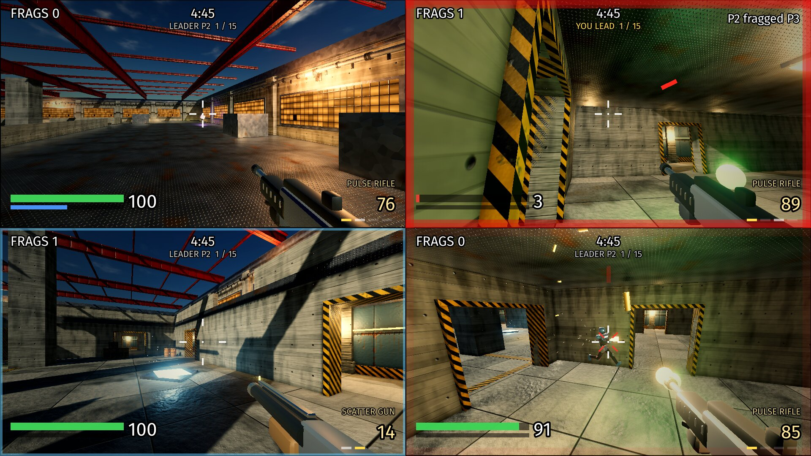
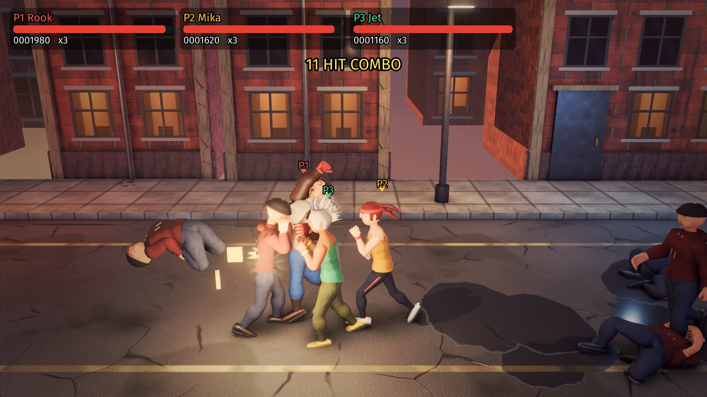
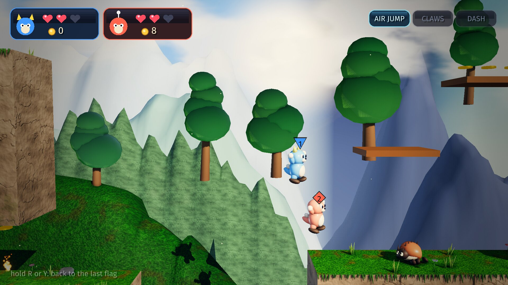
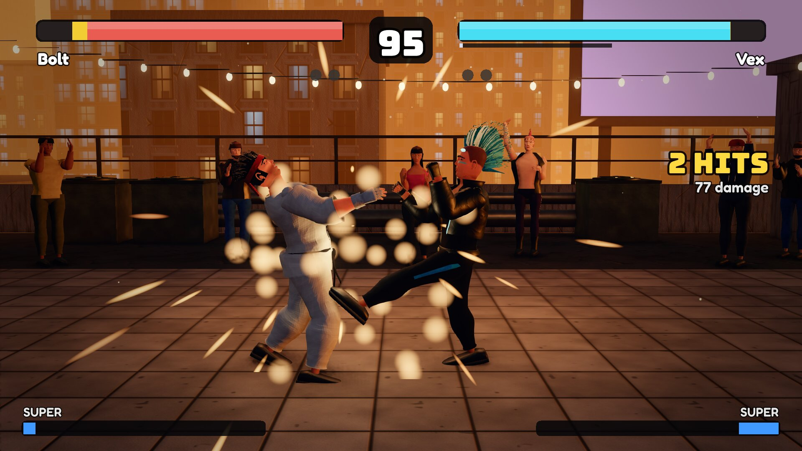
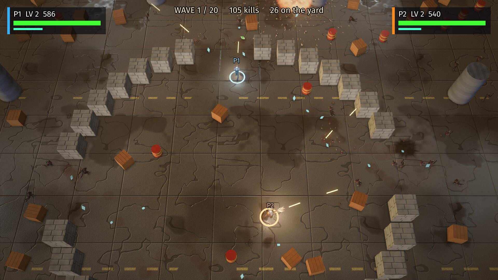
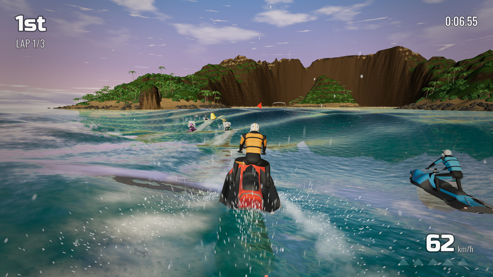
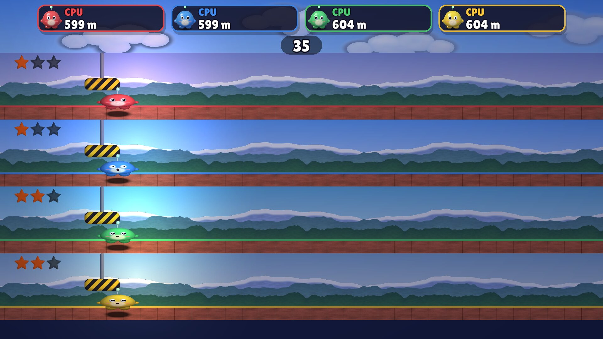
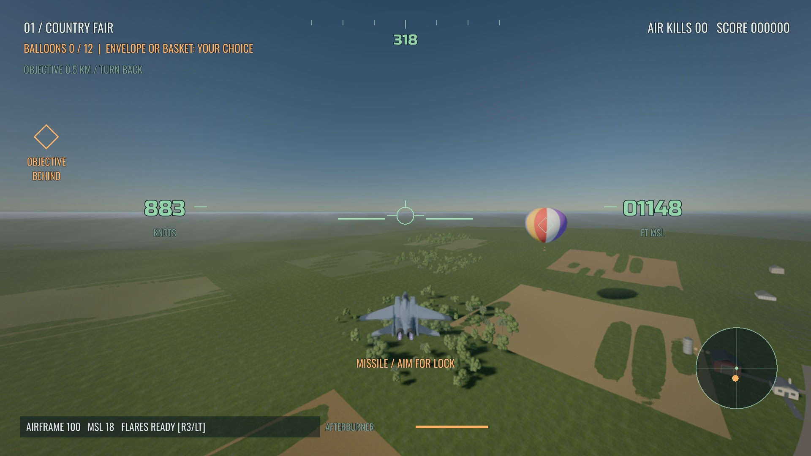
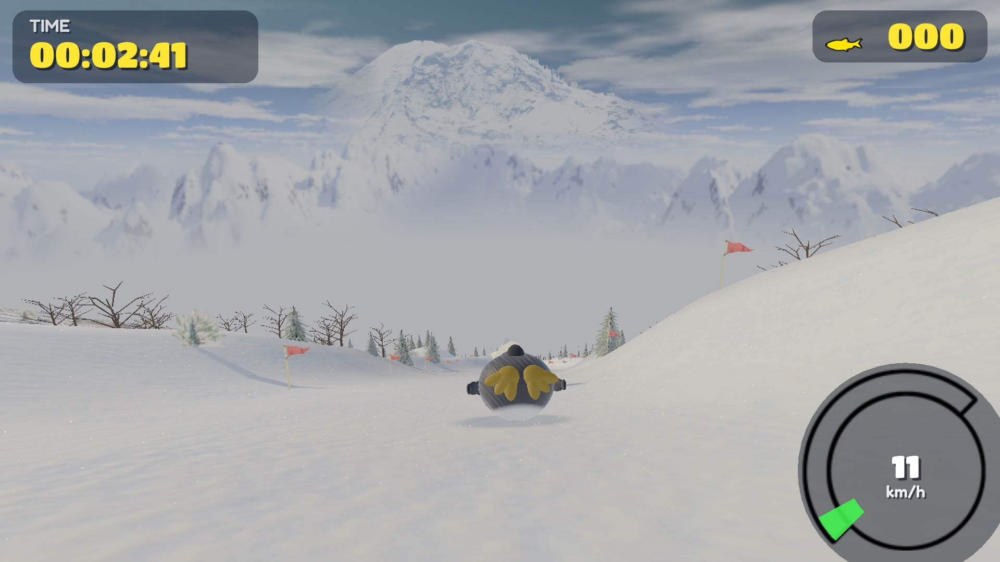

# more-cartwheel-examples

[](https://github.com/monteslu/more-cartwheel-examples/actions/workflows/ci.yml)

Eight more games built with
[cartwheel-engine](https://github.com/monteslu/cartwheel-engine), a 2D and 3D
game engine in C, after the ones in
[cartwheel-examples](https://github.com/monteslu/cartwheel-examples). Each
game is written to push the engine: to find what it lacks (split screen for
four, crowds of thousands, skinned fighters, ragdolls, a party game's many
small scenes) so the generic fixes go back into the engine. Six of the games
are for one to four players on one machine, one pad each; Sky Fighter and Tux
Racer are for one player.

The games ship as [wasmcart](https://github.com/wasmcart/wasmcart) carts
(`.wasc`): one file per game that runs in a browser, in Node, in a native
player and in RetroArch, with GL and WebGPU in the same cart.

In six of the games everything is made by code in this repository (models,
textures, levels, sound and music) except a few fonts, which ship with their
licence (SIL Open Font License). Sky Fighter also builds on CC0 and
public-domain sources (Poly Haven surface scans, an F-15 model, open
elevation data, a U.S. Air Force engine recording), and Tux Racer is a
reimplementation of the GPL original with its data, so that one game is
GPL-2.0-or-later. Each game's `CREDITS` file says what is what.

## The games

### arenafps



A first-person arena shooter for one to four players in split screen, with
bots that find their way over a navigation mesh, take the jump pads and drop
from the roofs. Three two-level arenas (Foundry, Courtyard, Terraces), each
with its own light design, and three modes: deathmatch, team deathmatch and
co-op waves against the bots. Four weapons: a pulse rifle, a scatter gun,
rockets and a rail gun. Move with the left stick, look with the right, fire
with the right trigger, jump with (A), change weapons with (Y) and (X).
`games/arenafps/` (its [README](games/arenafps/README.md) has the full
controls).

### brawler



A side-scrolling street brawler for one to four players on one shared
screen. Four stages (an alley, the docks, an arcade and a roof), a crowd that
surrounds you, crates and barrels with food and weapons, and a three-phase
boss at the end of each stage. Knocked-down bodies fall loose as ragdolls.
Attack with (X), kick with (Y), jump with (A), grab with the right bumper,
spin with the left. `games/brawler/` (its [README](games/brawler/README.md)
has the full controls).

### coopplatformer



A co-op side-scrolling platformer for one to four players on one shared
screen. The camera pulls back to keep everyone in view, and anyone left behind
is carried to the group in a bubble. Four regions left to right (a meadow,
torchlit caves, a flooded ruin and a volcano with a boss), three abilities
that open the way (an air jump, wall claws and a dash), secrets and a map
screen. Jump with (A), dash with (X), the map on Back.
`games/coopplatformer/` (its [README](games/coopplatformer/README.md) has the
full controls).

### fighter



A one-on-one fighting game: 2D rules, 3D look. Two players, or one against
the computer. Four fighters, three stages, special moves on stick motions,
parries, throws, and a training mode that shows hitboxes and frame data.
Punch with (X), kick with (A), block with (B); the stick picks a high, mid or
low attack. `games/fighter/` (its [README](games/fighter/README.md) has the
full controls and the move notation).

### hordeshooter



One to four players hold a walled yard against a horde that never stops
coming, on one shared camera that zooms out to keep everyone in view. Gems
level you up into upgrades, power-ups lie around the yard (shotgun, rail
gun, flamer, buzzsaws, shields...), a boss comes every fifth wave, and the
yard is held after the boss of wave 20. Move with the left stick, aim and
fire with the right, throw a blast with the left shoulder.
`games/hordeshooter/` (its [README](games/hordeshooter/README.md) has the full
controls and the power-up list).

### jetski



jetski, a wave racing game on one evening's water. Six riders race three laps around a volcanic
atoll, from a pale lagoon through a gap in the reef and out across open sea. The water is the track: its swells throw you
into the air, the sea builds from lap to lap, and every buoy you pass on the correct side raises your top speed. One
player and computer racers for now. See [its README](games/jetski/README.md).

### partypack



A party game for one to four players on one shared screen; CPU players fill
the empty seats. A board tournament of four, six or eight rounds over eleven
mini-games (2D, 2D physics, 3D racing and 3D water: Hurdle Dash, Echo, Stack
Attack, Blast Ring, Beat Box, Loop Racers, Quick Quiz, Raft Rush, Sumo Push,
Coin Rush, Tile Drop), free play and a trophy room. Each mini-game's card
names the buttons it uses. `games/partypack/` (its
[README](games/partypack/README.md) has more).

### skyfighter



Sky Fighter, an arcade jet combat game for one player. Eight missions, each
over its own terrain with its own targets: hot-air balloons over farmland,
prop fighters and dirigibles in an alpine valley, fuel depots in a desert
canyon, interceptors over an island, a mothership over a city, a snowbound
fortress, the North Pole, and oil rigs at dusk. Guns, guided missiles,
flares, an afterburner and an airbrake; a crash breaks the jet into Box3D
pieces. Bank and pitch with the left stick, guns on the right trigger,
missiles with (X), afterburner with (B), flares with the left trigger.
`games/skyfighter/` (its [README](games/skyfighter/README.md) has the mission
table and the full controls).

### tuxracer



Tux Racer, a work-in-progress reimplementation of the classic
[Tux Racer](https://tuxracer.sourceforge.net/) 0.61 (Jasmin Patry and
Sunspire Studios, 1999 to 2001, GPL) on cartwheel-engine. Tux belly-slides
down the original courses, with the original penguin, music and sounds
converted from the GPL data, the sliding rebuilt on Box3D, and the look on
the engine's PBR terrain, sky, cascaded shadows, particles and post effects.
Practice on any of the 13 courses in sunny, cloudy or night conditions, or
race the Canadian Cup. Steer with the stick, paddle with (A), brake with (B),
jump with (X). One player. GPL-2.0-or-later, see its LICENSE and CREDITS.
`games/tuxracer/` (its [README](games/tuxracer/README.md) has the controls
and the credits).

## Play

Tagged versions are on the
[Releases](https://github.com/monteslu/more-cartwheel-examples/releases)
page: one cart per game, `<game>.wasc` (`arenafps.wasc`, `brawler.wasc`,
`coopplatformer.wasc`, `fighter.wasc`, `hordeshooter.wasc`,
`partypack.wasc`, `skyfighter.wasc`, `tuxracer.wasc`). Each cart holds GL and WebGPU: a host that has WebGPU
runs it on WebGPU, any other on GL. Every push to `main` also builds them:
the repository's
[Actions](https://github.com/monteslu/more-cartwheel-examples/actions) tab,
the latest green run, then **Artifacts** (`release-carts`).

Hosts that run the carts:

| Host | How |
|---|---|
| [wasmcart](https://github.com/wasmcart/wasmcart), the web and Node player | `npx wasmcart partypack.wasc`, or open the cart in its web player |
| [wasmcart-native](https://github.com/wasmcart/wasmcart-native), a native player | `wasmcart-run partypack.wasc` |
| [wasmcart-libretro](https://github.com/wasmcart/wasmcart-libretro), a libretro core | load the cart in RetroArch (it runs a cart's GL path) |

Plug in one pad per player; player 1 can also use the keyboard.

## Build

The games build against cartwheel-engine's prebuilt SDKs: the engine,
three.c, Box2D, Box3D and the rest come compiled (one SDK per target,
attached to the engine's release; see the engine's
[docs/sdk.md](https://github.com/monteslu/cartwheel-engine/blob/main/docs/sdk.md)),
so a build compiles only the games. You need cmake, ninja, a C17 compiler,
Node.js, git and curl; on Linux also the EGL and GLESv2 runtime (Mesa). On
Ubuntu:

```sh
sudo apt-get install cmake ninja-build clang nodejs npm curl libegl1 libgles2
```

Then:

```sh
scripts/fetch-deps.sh   # the cart SDK and this machine's SDK, pinned with sha256 in scripts/deps.lock
scripts/build.sh        # build/cart-wgpu (the carts) and build/native (the same games as native programs, for the tests)
```

| Tree | What | Where |
|---|---|---|
| `build/cart-wgpu` | the dual GL + WebGPU carts, the ones that ship | `build/cart-wgpu/carts/<app>.wasc` |
| `build/native` | native executables, this machine's compiler: what the gates compare the carts with | `build/native/games/<game>/<app>` |

`TARGETS=cart-wgpu` (or `native`) builds one tree. Carts link as dev carts
by default (no ThinLTO, no wasm-opt: seconds instead of a minute, the same
simulation); `RELEASE=1` links them as releases ship. Any arguments go to
ninja: `scripts/build.sh -j4 fighter` builds only fighter in each tree.

### Building native yourself

Releases ship the carts only, but every game also builds as a native
program for Linux x64 and arm64, Windows x64, macOS arm64 and Android arm64.
Fetch the target's SDK and toolchain, build its tree, and package it with the
engine's cwexport and the game's `project.cwproj` presets:

```sh
CW_SDK_TARGETS=linux-x64 CW_TOOLCHAINS=1 scripts/fetch-deps.sh
TARGETS=linux-x64 scripts/build.sh
node deps/cartwheel-sdk/linux-x64/tools/cwexport.mjs --project games/fighter --preset linux-x64 --build build/linux-x64
```

The trees are `linux-x64`, `linux-arm64`, `windows-x64` (cross-compiled on
Linux), `android-arm64` and `macos-arm64` (on a Mac); the preset has the
same name. A native build renders with WebGPU (Dawn) and falls back to OpenGL
ES 3.0; `CW_GPU=gl` or `CW_GPU=webgpu` picks one.

To build the engine from source instead (to work on it, or on a machine no
SDK runs on), fetch with `CARTWHEEL_ENGINE_SOURCE=1 scripts/fetch-deps.sh`
(the engine at the pinned commit and its own dependencies) or
`CARTWHEEL_ENGINE=../cartwheel-engine scripts/fetch-deps.sh` (a checkout);
`scripts/build.sh` then builds the engine with the games, as the engine's
project.

## Run

Natively:

```sh
build/native/games/arenafps/arenafps
```

The carts with any wasmcart host:

```sh
npx wasmcart build/cart-wgpu/carts/arenafps.wasc
```

Each game also builds a `<game>_auto` app that plays by itself (bots or CPUs
in every seat), for the tests and screenshots.

## Tests

The gates are in `tests/gates.json` (arenafps, hordeshooter) and
`tests/<game>-gates.json` (the others). A gate runs an app on every host it
names with the same frame count and input script, and compares each run with
the native one: the frames within a pixel bound, and the game's named debug
state (scores, positions, hashes of the simulation) exactly. Each gate also
runs a control (one frame short, or a different input) that must fail, so a
gate that cannot tell runs apart fails too. Gates with a `webgpu` entry run
again on WebGPU and are compared with the GL run.

```sh
node tests/gate.mjs --hosts native                                   # tests/gates.json, native, GL
node tests/gate.mjs --gates-file fighter-gates.json --gpu webgpu     # fighter's gates on WebGPU, every host they name
```

`tests/gate.mjs` runs cartwheel-engine's gate runner with `CW_PROJECT_ROOT`
set to this repository. The engine's
[testing guide](https://github.com/monteslu/cartwheel-engine/blob/main/docs/guides/testing.md)
covers the hosts (native, Chromium, wasmcart-native, romdev), the test GPU
settings it expects in `~/.config/cartwheel/`, and the gate format. Without
GPU hardware, `CW_TEST_GPU=software` runs on Mesa's software renderers
(llvmpipe for GL, lavapipe for WebGPU), as CI does.

`tests/cart-smoke.mjs` plays each `_auto` cart for a few frames in wasmcart's
Node host (what CI runs). `tests/native-replay.mjs` runs each game's replay
gate (a self-playing `<game>_auto` session) on a native build without the
gate runner, and `tests/compare-replays.mjs` compares two such runs (GL and
WebGPU, say) field for field.
`tests/arenafps-split-bench.mjs` measures what each extra split-screen view
costs, and `scripts/partypack-suite.sh` runs partypack's checks in pieces.

## CI

[`.github/workflows/ci.yml`](.github/workflows/ci.yml) runs on every push to
`main`, on pull requests and by hand (workflow_dispatch), against the pinned
cart SDK. It builds the eight carts and the self-playing `<game>_auto` carts
of the six games that have one, and runs `tests/cart-smoke.mjs`: each game's
`_auto` cart (or its own cart where it has none) plays 60 frames in
wasmcart's Node host on Mesa's software Vulkan (lavapipe, the WebGPU path),
must exit cleanly and leave a picture that is not blank. The gates, which
compare the carts with native runs on every host, run locally on a GPU
(`tests/gate.mjs`).

Pushes to `main` link the carts as releases ship. Pushing a `v*` tag does not
build anything: it takes the eight `<game>.wasc` from that commit's green run
on `main` and publishes them as a GitHub release, its notes taken from
[CHANGELOG.md](CHANGELOG.md). Push to `main`, wait for the run to go green,
then `git tag v0.3.0 && git push origin v0.3.0`.

## Layout

| Path | Contents |
|---|---|
| `games/<game>/` | one game: its C sources, `CMakeLists.txt`, `CREDITS`, `README.md`, `project.cwproj` (native export presets), its assets and `tools/` |
| `games/<game>/tools/` | the scripts that generate the game's assets (models, textures, levels, colour grades, sound), committed next to their output |
| `games/<game>/programs/` | the game's three.c program table: `<game>.txt` and the C generated from it |
| `tests/` | the gates, their input scripts, the gate and replay runners, the cart smoke test, benchmarks |
| `scripts/deps.lock` | the pinned cartwheel-engine commit and its SDKs (sha256) |
| `scripts/fetch-deps.sh`, `scripts/build.sh` | fetch the SDKs (or the engine) and build |
| `CMakeLists.txt` | the top of the build against an SDK (`find_package(cartwheel)`), adding each game; with the engine from source, the engine's project |
| `deps/`, `build/`, `out/` | fetched dependencies, build trees, test output (all gitignored) |

## Working on the games

- Each game is a cartwheel app: `cw_main` returns a `cw_app_desc` with a
  fixed-tick update and a render callback. The engine's headers
  (`deps/cartwheel-sdk/<host>/include/cartwheel/*.h`) are its API reference.
- The simulation is deterministic on every host: fixed ticks, randomness from
  `cw_rng`, trig from `cartwheel/math.h`, no fast-math. State a gate checks
  is published by name with `cw_debug_*`.
- Generated assets come from the game's `tools/` scripts: change the script,
  rerun it and commit both.
- When a game draws a new material state, the gates fail and name it. Add it
  to the game's program table with the engine's tool,
  `node deps/cartwheel-sdk/<host>/tools/programs.mjs <app> --build build/native`,
  and commit the generated files.
- To work on the engine and the games together, link an engine checkout:
  `CARTWHEEL_ENGINE=../cartwheel-engine scripts/fetch-deps.sh`. Engine
  changes go into cartwheel-engine first; then pin its new release in
  `scripts/deps.lock`.
- A change is done when its gates pass natively on GL and WebGPU.

## License

MIT, see [LICENSE](LICENSE), except `games/tuxracer`, which is
GPL-2.0-or-later (its [LICENSE](games/tuxracer/LICENSE) and
[CREDITS](games/tuxracer/CREDITS): the original Tux Racer's courses, model,
music and sounds are GPL v2). The fonts keep their own licence (SIL Open Font
License 1.1), shipped beside each font.
