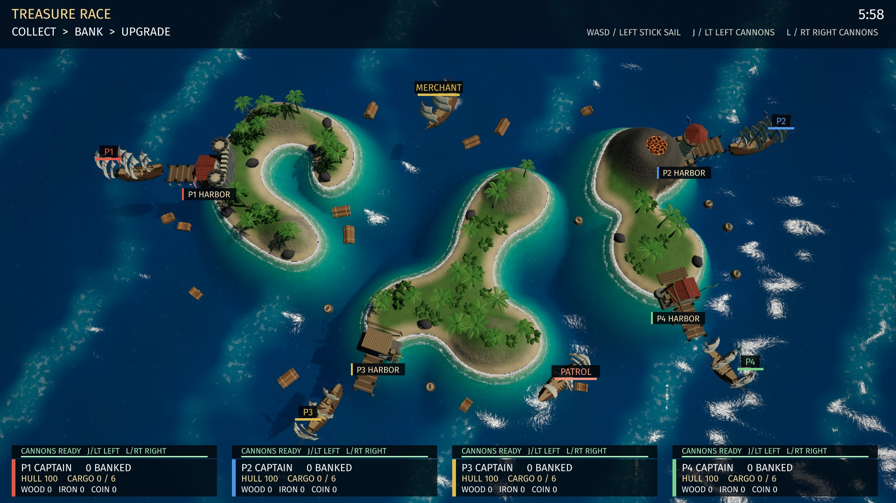

# Pirates



A real-time naval game for one to four players sharing one screen. This is
an in-development example, not yet a release-quality game. The current maps
have rounded bays, peninsulas, shallow water and harbors; ships collect cargo,
fire broadsides and buy visible upgrades.

## Play

On the title screen, other players press START on their own controllers to
join. Player one chooses the mode and map, then presses ENTER / START to sail.
Keyboard controls belong to player one; each controller owns one captain.

| Action | Keyboard | Controller |
| --- | --- | --- |
| Turn / sail / reverse | WASD or arrows | Left stick or D-pad |
| Left broadside | J | Left trigger |
| Right broadside | L | Right trigger |
| Bank cargo / repair at your harbor | E | South / A |
| Buy hull upgrade | 1 | West / X |
| Buy sail upgrade | 2 | North / Y |
| Buy cannon upgrade | 3 | East / B |
| Choose mode on title | Q / R | Shoulder buttons |
| Choose map on title | T | SELECT / Back |
| Begin / join | ENTER | START |
| Pause / resume | ESC | START |
| Return to title while paused | Q | SELECT / Back |

Sail over timber bundles, iron barrels and treasure chests to collect them.
Your hold carries six items; a full hold slows the ship. Return within six
metres of your own harbor and bank the cargo. Banking adds score, stores the
resources for upgrades, and repairs up to 20 hull if you delivered cargo.
Each upgrade costs two of its resource: timber for hull, coins for sails,
iron for cannons. Each can be bought twice. Spending stored resources does
not reduce banked score.

Aim with your ship's side, not its bow. Cannons fire a three-shot broadside.
Both sides share one reload timer. The meter above your status panel shows
when the crew is ready, the remaining reload time, and left/right controls.
Sinking drops your carried cargo but keeps banked score and purchased
upgrades. Captains respawn after two seconds with four seconds of protection;
firing ends that protection immediately. Salvage expires after 30 seconds.

## Modes and maps

- **Cooperative Voyage:** supply the fleet, sink the patrol, then deliver a
  final haul before twelve minutes expire. Friendly fire is off. The quota
  and patrol health scale from one to four human captains. Unjoined captain
  slots remain inactive in this mode; solo play is a complete voyage.
- **Treasure Race:** six minutes to bank the most cargo. Unjoined captain
  slots become AI rivals. Equal leading scores produce a draw.
- **Team Treasure Race:** P1 + P3 against P2 + P4, with AI filling empty seats.
  Friendly fire is disabled within each partnership.

**The Gilded Shoals** has an active volcano. Starting at 18 seconds, three
rockfall zones are marked every 30 seconds. Leave the circles during the
3.5-second warning; impacts deal 28 damage within 3.2 metres. Harbor docking
areas are outside the impact zones. **Palm Lagoon** has sheltered coves and
no volcanic hazard, making it the calmer map to learn.

## Build from the current engine source

CMake discovers this directory automatically and creates `pirates` and
`pirates_auto`. The latter runs four AI captains in Treasure Race.

The current game was verified against the adjacent development checkout of
cartwheel-engine, with three local fixes: water's paused render clock in
`src/water/water.c`, and external-encoder vertex-buffer lifetime in
`deps/three.c/src/gen_wgpu.c`, plus shallow-water refraction attenuation in
`src/water/extensions/water.mjs`. The repository's older pinned SDK does not
include those fixes. Do not treat an older SDK build as equivalent to the
verified source build. Their evidence is in `art/RECOVERY-PAUSE-VERIFICATION.txt`
and `art/REFRACTION-VERIFICATION.txt`; shoreline sampling evidence is in
`art/SHORE-REFRACTION-VERIFICATION.txt`.

The pinned 0.29.0 Linux SDK compiles both targets and passes the short GL
gameplay replay, but its engine source still lacks the water-pause and
near-shore refraction fixes. See `art/SDK-COMPATIBILITY-VERIFICATION.txt`.
Use the patched source build below for the currently verified presentation.
CI separately builds and smoke-tests Pirates against the pinned SDK for
compatibility. It remains excluded from release downloads; that short check
does not replace the patched-build gameplay and visual verification.

From the more-cartwheel-examples root, with the prepared engine checkout at
`../cartwheel-engine` (CMake, Ninja and the engine toolchains installed):

The exact source baseline is cartwheel-engine commit
`6f16bbf19b5a3b439c40d19e60104110e8f0a49c`, with its pinned three.c commit
`5c882fc1accdc2243608fd4d373911622d4a9164`. Prepare dependencies with the
engine's `scripts/fetch-deps.sh` before applying the fixes below. For a new
checkout, clone `https://github.com/monteslu/cartwheel-engine.git`, check out
the engine commit above, then fetch dependencies from that checkout.
Use a separate checkout if your existing engine has unrelated work.

All three fixes and the external-encoder regression test are bundled in
`engine-patches/`. The buffer patch matches three.c commit
`f967d958ff4fdbf93fbf7789dfa77817ff8a5079`
([upstream PR](https://github.com/monteslu/three.c/pull/1)); the
[engine PR](https://github.com/monteslu/cartwheel-engine/pull/1) now pins that
commit directly. This bundle supports the older source baseline above. The preparation script checks both revisions and all
patches before applying missing changes; it never fetches or resets files.
An already patched checkout is accepted. Recheck after fetching dependencies,
because the engine dependency fetcher may restore its pinned three.c sources.

```sh
python3 games/pirates/tools/prepare-engine.py ../cartwheel-engine --apply
# Read-only check; nonzero means missing fixes, conflicting edits or wrong pins:
python3 games/pirates/tools/prepare-engine.py ../cartwheel-engine
```

```sh
cmake -S ../cartwheel-engine -B build/pirates-current -G Ninja \
  -DCMAKE_BUILD_TYPE=Release -DCW_ENGINE_ONLY=ON -DCW_WGPU=ON \
  -DCW_PROJECT_DIR="$PWD"
ninja -C build/pirates-current pirates pirates_auto cwpack
cmake -S ../cartwheel-engine -B build/pirates-current-cart -G Ninja \
  -DCMAKE_BUILD_TYPE=Release -DCW_ENGINE_ONLY=ON -DCW_WGPU=ON \
  -DCW_PROJECT_DIR="$PWD" -DCW_CART_DEV=ON \
  -DCMAKE_TOOLCHAIN_FILE="$PWD/../cartwheel-engine/cmake/cart.cmake" \
  -DCW_CWPACK="$PWD/build/pirates-current/tools/cwpack/cwpack"
ninja -C build/pirates-current-cart pirates pirates_auto
```

Native executables are under `build/pirates-current/project/games/pirates/`;
carts are under `build/pirates-current-cart/carts/`. The development cart
contains GL and WebGPU paths. To build with release optimization, use the
same cart configure command with a separate `build/pirates-release-cart`
directory, `-DCW_CART_DEV=OFF` and `-DCW_CART_LINK_JOBS=2`, then build its
`pirates` and `pirates_auto` targets. This build passes short and full-match
romdev replays on both WebGPU and OpenGL, plus the playable startup check.
Exported platform packages still need verification.
See `art/RELEASE-CART-VERIFICATION.txt`.

## Assets

Committed GLBs and program tables are sufficient to build; Blender is needed
only to regenerate art. Run the scripts with Blender 4.2.9, for example:

```sh
blender -b --disable-autoexec -t 8 --python games/pirates/tools/make-coast.py
blender -b --disable-autoexec -t 8 --python games/pirates/tools/make-coast.py -- --lagoon
```

The terrain generator writes the model, albedo, editable blend and matching
collision/height header together. Keep those outputs together. Other Blender
scripts prepare the licensed galleon and generate harbors, cargo and upgrades.
See [CREDITS](CREDITS) for ownership and source information.
The original looping sea ambience is regenerated with
`python3 games/pirates/tools/make-ambience.py` (no Blender or audio packages needed).

## Verification

Use romdev to load the built `pirates.wasc` as platform `wasmcart`, step frames,
exercise controller inputs and inspect screenshots. Successful `loadMedia`
can return empty content; follow it with a frame step. A successful build or
a native screenshot alone is not romdev verification.

Runtime debug commands exercise actual gameplay functions and reset the match:

- `pirates_test_hull`: check bow/stern shore clearance, turning, reverse escape
  and spawns on both maps.
- `pirates_test_route`: skip an unreachable cove pickup and continue banking.
- `pirates_test_escape`: reproduce the previously stalled P3 shoreline turn
  and check safe escape and banking. Add `1` to start it for rendered stepping.
  `pirates_test_escape 0 1` checks the P1 stopped-turn case; `1 1` starts it live.
- `pirates_ai 0` through `5`: inspect a ship's pose, waypoint and shore clearance.
- `pirates_profile 590`: collect continuous rendered frames, then return CPU
  timing statistics inside that run. Use romdev command `maxFrames:600`.
  This avoids including idle gaps between tool calls in the frame timer.
- `pirates_impact 0` / `1` / `2`: fire ordinary projectiles into sea, hull or
  shore for visual checks. `pirates_effects` reports particle pool counts.
- `pirates_simulate N`: reset an AI race and run up to 21,600 gameplay ticks
  without intermediate rendering. Useful for logic diagnosis; reload before
  visual checks because water and particle effects are not advanced normally.
- `pirates_test_recovery`: sinking, protection duration, expiry and firing.
- `pirates_sink 0` through `5`: apply lethal damage through the normal damage
  rules to inspect sinking; existing respawn protection still blocks damage.
- `pirates_test_salvage`: cargo manifest, retained upgrades and restart.
- `pirates_test_voyage 1` through `4`: objective transitions and scaling.
- `pirates_test_eruption`: warning, damage, harbor clearance, Lagoon isolation,
  and 24 AI escape scenarios. Reload before visual evaluation: this scenario
  creates many immediate splashes that persist briefly in the water.
- `pirates_map 0` / `1` and `pirates_match <mode 0..2> <humans 1..4>` set up play.

The replay manifest is `tests/pirates-gates.json`. Native replay entry:

```sh
node tests/native-replay.mjs --bin build/pirates-current/project \
  --out out/pirates-replay-gl --gpu gl pirates

# Complete six-minute match, checking all full-match expectations:
node tests/native-replay.mjs --bin build/pirates-current/project \
  --out out/pirates-full-gl --gpu gl --gate pirates-race-full pirates
```

The native replay runner writes live diagnostics to `<out>/pirates.log` and
the final selected state to `<out>/pirates.json`. A missing final dump is not
a passing result. `--gate` selects the full gate's frame count and assertions;
`--frames` alone is a state capture and does not check end-of-match expectations.

Evidence and limitations for individual features are recorded under `art/`.
`art/FULL-RACE-VERIFICATION.txt` records a complete rendered romdev race.
`art/FULL-TEAMS-VERIFICATION.txt` records a complete rendered team race,
including an unresolved late-run frame-delivery slowdown.
`art/NATIVE-PERFORMANCE-VERIFICATION.txt` records three 1080p hardware GL
replays on a Radeon 890M, with sampled frame averages of 6.65–6.79 ms;
these measurements do not establish full-match or cross-hardware performance.
`art/NATIVE-FULL-PERFORMANCE-VERIFICATION.txt` records a full native GL race
and its final-600-frame timings; the romdev slowdown did not reproduce there,
but WebGPU and host-side causes remain unverified.
`art/NATIVE-WEBGPU-PERFORMANCE-VERIFICATION.txt` adds a full native WebGPU
race with identical gameplay state and no reproduced late-match slowdown.
The remaining performance investigation concerns the cart host and workload
differences. `pirates-race-full` in the gate manifest preserves the full-match
expected state; the native replay runner still defaults to the short gate.
Use `--gate pirates-race-full` for its full-match assertions.
`art/CURRENT-FULL-PERFORMANCE.txt` verifies the latest native WebGPU build
through a complete race, with six timing samples and the full expected state.
It includes the recent terrain, sail, sinking and audio changes; sampled
frame averages were 7.96–8.49 ms at 1080p on a Radeon 890M. Occasional frames
exceeded 16.7 ms. Current full-match cart-host profiling remains outstanding.
`art/SHALLOWS-FULL-RACE-VERIFICATION.txt` records a full rendered romdev
race with the current navigation and shallows: all 13 final-state fields
matched, with zero GPU errors or skipped draws, and results/restart worked.
This correctness check did not collect frame-time samples. Its subsequent
interactive WebGPU window was slow and the romdev connection failed; a native
GL build is available for human playtesting while that host issue is investigated.
Outstanding work includes human playtesting, richer art, broader performance coverage,
cross-host replay coverage, SDK integration and release packaging.
